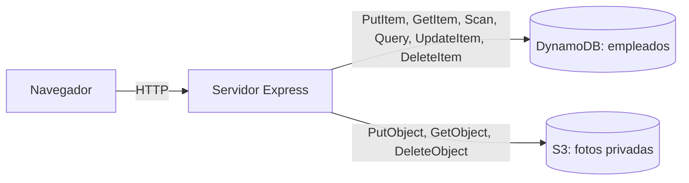

# Laboratorio 13: CRUD de empleados con DynamoDB y S3

Curso: Desarrollo de Soluciones en la Nube · 5 - C24 Sección ABCD · Docente: Jaime Farfán

Aplicación web para gestionar la tabla `empleados`. Los datos viven en **Amazon DynamoDB** y la foto de cada empleado en **Amazon S3**. La interfaz muestra una credencial que se arma en vivo mientras se completa el formulario.

Repositorio: <https://github.com/JasonGomezzz/LAB13-DSN>

## Qué pide el enunciado y dónde se cumple

| Requisito | Cómo se cumple |
| --- | --- |
| CRUD de la tabla `empleados` en DynamoDB | `src/repositories/empleadosRepository.js` (crear, obtener, listar, actualizar, eliminar) y rutas REST en `src/routes/empleadosRoutes.js` |
| La foto se almacena en S3 | `src/repositories/fotosRepository.js`: la imagen va a un bucket privado, cifrado y con acceso público bloqueado. En DynamoDB solo se guarda la clave del objeto |
| Mostrar evidencias | `docs/evidencias/` (salidas reales de comandos) y `docs/capturas/` (capturas de la consola de AWS, ver "Te toca a ti") |
| Conclusiones | Sección final, como borrador para editar |

## Arquitectura



- El navegador **nunca habla con AWS**. Todo pasa por la API, que es la única con permisos.
- La foto se sirve a través de la API (`GET /api/empleados/:id/foto`), así el bucket permanece privado y no hay URLs firmadas que caduquen o se compartan.
- `dni-index` (índice secundario global) permite rechazar DNI repetidos sin escanear toda la tabla.

## Requisitos

- Node.js 22.9 o superior
- Docker (para AWS local con LocalStack)
- AWS CLI v2, solo para trabajar contra la cuenta real

## Instalación y ejecución en local

```bash
npm install
cp .env.example .env
docker compose up -d          # LocalStack con DynamoDB y S3
npm run aws:crear             # crea la tabla y el bucket (idempotente)
npm run dev                   # http://localhost:3000
```

Si el puerto 3000 está ocupado, cambia `PORT` en `.env`.

## Pasar a AWS real

El código es el mismo; solo cambia la configuración. No pongas claves en ningún archivo: usa un perfil de AWS CLI o el rol de la instancia.

1. Crea un archivo `.env.aws` (queda ignorado por git) **sin** `AWS_ENDPOINT_URL` ni claves, así no choca con tu `.env` de LocalStack:

```
PORT=3000
AWS_REGION=us-east-1
AWS_PROFILE=<tu-perfil>
DYNAMODB_TABLE=empleados
S3_BUCKET=<nombre-unico-en-todo-el-mundo>
MAX_FOTO_MB=2
```

2. Inicia sesión (`aws login --profile <tu-perfil>` o `aws sso login --profile <tu-perfil>`), crea los recursos y arranca la app:

```bash
npm run aws:crear:real
npm run start:aws
```

S3 comparte el espacio de nombres entre todas las cuentas, por eso el nombre del bucket debe ser único.

**Costo aproximado:** la tabla usa facturación bajo demanda y el bucket almacena imágenes de pocos KB; para este laboratorio equivale a centavos o cero dentro de la capa gratuita.

**Limpieza al terminar** (borra la tabla y el bucket con todas las fotos; pide confirmación explícita):

```bash
npm run aws:eliminar:real -- --si
```

En local, la limpieza es `npm run aws:eliminar -- --si`.

### Permisos IAM mínimos

La API solo necesita estas acciones, limitadas a sus dos recursos:

- DynamoDB sobre la tabla y su índice: `GetItem`, `PutItem`, `UpdateItem`, `DeleteItem`, `Scan`, `Query`.
- S3 sobre `arn:aws:s3:::<bucket>/empleados/*`: `PutObject`, `GetObject`, `DeleteObject`.

Los scripts `aws:crear` y `aws:eliminar` necesitan además crear y borrar la tabla y el bucket; ejecútalos con un perfil de administración, no con el rol de la aplicación.

## Variables de entorno

Referencia completa en [`.env.example`](.env.example).

| Variable | Para qué sirve |
| --- | --- |
| `PORT` | Puerto del servidor (3000 por defecto) |
| `AWS_REGION` | Región de AWS (`us-east-1`) |
| `DYNAMODB_TABLE` | Nombre de la tabla |
| `S3_BUCKET` | Nombre del bucket de fotos |
| `AWS_ENDPOINT_URL` | Solo en local: apunta a LocalStack. Vacío en AWS real |
| `MAX_FOTO_MB` | Tamaño máximo de foto en MB (2 por defecto) |

## Modelo de datos

Tabla `empleados` (clave de partición: `empleadoId`, un UUID).

| Campo | Tipo | Notas |
| --- | --- | --- |
| `empleadoId` | texto | UUID generado por el servidor |
| `dni` | texto | 8 dígitos, único (índice `dni-index`) |
| `nombres`, `apellidos` | texto | 2 a 60 letras |
| `correo` | texto | en minúsculas |
| `cargo` | texto | 2 a 60 caracteres |
| `area` | texto | Tecnología, Recursos Humanos, Finanzas, Operaciones, Comercial, Marketing o Legal |
| `salario` | número | entre 0 y 1 000 000, dos decimales |
| `fechaIngreso` | texto | `AAAA-MM-DD`, no puede ser futura |
| `fotoKey` | texto | clave del objeto en S3; el atributo no existe si no hay foto |
| `creadoEn`, `actualizadoEn` | texto | fecha ISO 8601 |

## API

| Método y ruta | Qué hace | Respuestas |
| --- | --- | --- |
| `GET /api/empleados` | Lista ordenada por apellidos | 200 |
| `POST /api/empleados` | Crea un empleado | 201, 400 (validación), 409 (DNI repetido) |
| `GET /api/empleados/:id` | Obtiene uno | 200, 404 |
| `PUT /api/empleados/:id` | Reemplaza sus datos | 200, 400, 404, 409 |
| `DELETE /api/empleados/:id` | Elimina el registro y su foto | 204, 404 |
| `PUT /api/empleados/:id/foto` | Sube la foto (`multipart`, campo `foto`) | 200, 400, 404, 413 (pesada), 415 (no es imagen) |
| `GET /api/empleados/:id/foto` | Devuelve la imagen desde S3 | 200, 304, 404 |
| `DELETE /api/empleados/:id/foto` | Quita la foto | 200, 404 |
| `GET /api/configuracion` | Áreas y tamaño máximo de foto para la interfaz | 200 |

Los errores de validación responden con un mensaje por campo: `{ "error": "...", "detalles": { "dni": "El DNI debe tener 8 dígitos" } }`.

## Estructura

```
src/
  config/        variables de entorno validadas
  aws/           clientes de DynamoDB y S3
  repositories/  acceso a DynamoDB y a S3
  services/      reglas de negocio
  controllers/   traducen HTTP a llamadas al servicio
  middlewares/   subida de fotos y manejo de errores
  routes/        rutas REST
  utils/         validación, errores y detección del tipo de imagen
  app.js         arma Express (sin arrancarlo, para poder probarlo)
  server.js      arranque
public/          interfaz (HTML, CSS y módulos JS sin paso de compilación)
scripts/aws/     crear y eliminar la tabla y el bucket
test/            pruebas con node:test
testing/         repositorios en memoria usados por las pruebas
docs/            evidencias y capturas
```

## Seguridad

- **Foto validada por contenido.** Se comprueban los primeros bytes (JPG, PNG o WebP); el `Content-Type` que declara el cliente no se usa. Un archivo `.png` que en realidad es HTML se rechaza con 415.
- **Lista blanca de campos.** El cliente no puede definir `empleadoId`, `fotoKey` ni las fechas de auditoría.
- **Bucket privado**, con acceso público bloqueado y cifrado AES-256. La clave de S3 nunca sale de la API.
- **Sin inyección de HTML.** La interfaz construye el DOM con nodos de texto; un cargo como `` se muestra literal. Además, la política CSP solo permite recursos del mismo origen.
- **Sin secretos en el repositorio.** `.env` está ignorado; solo se versiona `.env.example`.
- **Límites:** cuerpo JSON de 20 KB, una sola foto por petición y tamaño máximo configurable.

## Cómo probar

```bash
npm test
```

31 pruebas: validación, detección de imágenes, reglas del servicio (DNI único, reemplazo y borrado de la foto, carreras entre subida y eliminación) y la API completa por HTTP (flujo CRUD, 400, 404, 409, 413, 415, cabeceras de seguridad).

Las pruebas usan repositorios en memoria, así que no requieren Docker. Contra LocalStack se verificó además a mano el recorrido completo desde la interfaz; ver [`docs/evidencias/local-localstack.md`](docs/evidencias/local-localstack.md).

## Desviaciones respecto al enunciado

1. **RDS frente a DynamoDB.** El documento se titula "RDS" y su topología muestra una instancia EC2 con RDS/MySQL en subredes privadas y un clúster con failover, pero la tarea escrita pide un CRUD en **DynamoDB** con fotos en **S3**. Se implementó la tarea escrita. DynamoDB es un servicio gestionado sin VPC ni subredes, por lo que la topología de la imagen no aplica a esta solución.
2. **Desarrollo local primero.** Para no gastar ni arriesgar la cuenta se desarrolló contra LocalStack 3.8.1. La conexión a AWS real es solo configuración (ver "Pasar a AWS real").
3. **Fotos servidas por la API** en lugar de un bucket público o URLs firmadas, para mantener el bucket privado.
4. **Recursos del documento no usados:** WordPress y el equipo virtual con Windows 10 no son necesarios para esta solución. El enlace al "Manual de configuración" (Google Drive) no se consultó.
5. **Moneda:** el salario se muestra en soles (S/).

## Te toca a ti

Esto no puedo hacerlo yo porque requiere tu cuenta o tu criterio:

- [x] Crear la tabla y el bucket en AWS real (hecho: `npm run aws:crear:real`, ver `docs/evidencias/aws-real.md`).
- [ ] Arrancar con `npm run start:aws` y crear 3 o más empleados desde la interfaz, con foto, contra AWS real.
- [ ] **Capturas** (guárdalas en `docs/capturas/` con estos nombres):
  - [ ] `01-dynamodb-tabla.png`: consola de DynamoDB, tabla `empleados`, pestaña Elementos de la tabla.
  - [ ] `02-s3-fotos.png`: consola de S3, bucket, carpeta `empleados/` con las imágenes.
  - [ ] `03-s3-acceso-publico.png`: pestaña Permisos del bucket, "Bloquear todo el acceso público" activado.
  - [ ] `04-app-lista.png`: la interfaz con la lista de empleados.
  - [ ] `05-app-credencial.png`: el panel de alta con la credencial y una foto elegida.
  - [ ] `06-app-eliminar.png`: la confirmación de eliminación y, después, la tabla sin ese elemento.
  - [ ] `07-npm-test.png`: salida de `npm test`.
- [ ] Revisar y firmar las conclusiones.
- [ ] Hacer `git push`.
- [ ] Al terminar, `npm run aws:eliminar:real -- --si` para no dejar recursos.

## Conclusiones (borrador, edítalas con tu voz)

1. **Las claves de S3 son parte del diseño de datos.** Cada subida usa un identificador nuevo en la clave del objeto. Así la URL cambia al reemplazar la foto y el navegador no muestra la anterior, y borrar la foto vieja es una operación independiente que puede fallar sin tumbar el guardado.
2. **Un objeto sin consumir también cuesta.** En una prueba, un script que pidió una foto a S3 y no leyó el cuerpo se quedó colgado. El stream mantiene el socket abierto: hay que consumirlo o destruirlo (`pipeline` lo destruye si el cliente corta).
3. **DynamoDB no tiene restricciones de unicidad**, y un `Scan` por DNI no escala. Se resolvió con un índice secundario global. Sigue existiendo una pequeña ventana de carrera entre la consulta y la escritura; con tráfico real habría que usar una transacción con un elemento de bloqueo por DNI.
4. **`null` y "no existe" son cosas distintas en DynamoDB.** Al quitar la foto se guardaba `fotoKey` como `NULL`; se corrigió con `REMOVE` para que el dato refleje la realidad.
5. **Validar por contenido, no por lo que declara el cliente.** El `Content-Type` y la extensión se falsifican con una línea de `curl`; los primeros bytes del archivo no.
6. **Desarrollar contra un emulador ahorra costo, pero no verifica IAM.** LocalStack acepta cualquier credencial. Los permisos reales solo se comprueban en la cuenta de AWS, por eso la lista de permisos mínimos está documentada aparte.
